# MAO UI 디자인 시스템 명세 및 후보군 비교 분석 (Issue #108)

본 문서는 MAO 데스크톱 애플리케이션(`electron/` + `src/`)과 헤드리스 CLI(`cli/`)가 공유하는 **선택 가능한 디자인 시스템(Selectable Design System)**의 사전 조사, 동일 화면·동일 샘플 데이터 기반 후보군 비교 분석 및 실제 캡처 스크린샷, 최종 구현 대상 선정 근거, 그리고 시맨틱 CSS 토큰 계약을 정의합니다.

---

## 1. 기존 화면 및 토큰 조사

### 1.1 기존 토큰 구조 (`src/index.css`)
기존 렌더러 스타일시트는 `:root`(라이트 모드 기본값)와 `:root[data-theme='dark']`(다크 모드 오버라이드) 두 블록에 단일 시각 언어(웜 스톤 배경 + 버밀리온 포인트)만 정의하고 있었습니다.

| 분류 | 기존 토큰 | Light 값 | Dark 값 | 조사에서 확인된 한계점 |
| --- | --- | --- | --- | --- |
| 배경/표면 | `--color-bg`, `--color-surface` | `#f3f2f2`, `#eae9e9` | `#1a1817`, `#262322` | 3단계 표면 계층(`--color-bg-subtle`)이 정의되지 않아 중첩 영역(코드/프롬프트 블록, 프리셋 행)의 시각적 구분이 약함 |
| 텍스트/구분선 | `--color-text`, `--color-divider` | `#201e1d`, `rgb(32 30 29 / 0.4)` | `#f3f2f2`, `rgb(243 242 242 / 0.16)` | 비-Classic 디자인용 1px 보조 보더 토큰(`--color-border`)과 불투명 보조 텍스트 토큰(`--color-text-muted`)이 분리되어 있지 않음 |
| 브랜드/강조 | `--color-accent`, `--color-accent-2` | `#ec3013`, `#e15b47` | `#ff6a4a`, `#ff8f78` | 브랜드 액센트, 주요 액션(`.btn-primary`), 사이드바 선택 행(`.sidebar-item.active`), 오류/실행 중 상태가 동일 계열에 결합됨 |
| 배지/태그 | `--color-accent-100`/`700`/`800`, `--color-neutral-100`/`800` | `#fff2ef` / `#ae1800` / `#7c1405`, `#f8f4f4` / `#444141` | `#3a1c14` / `#ffab94` / `#ffd3c4`, `#2c2928` / `#d8d4d4` | `Crimson Signal`처럼 붉은색을 주조로 쓸 때 브랜드 색과 오류(`.tag-danger`), 일시정지(`.tag-warn`), 완료(`.tag-success`)가 혼동될 수 있음 |
| 타이포그래피 | `--font-heading`, `--font-body` | `'Archivo', system-ui, sans-serif` | 동일 | 프롬프트(`<pre>`) 및 코드 블록용 고정폭 토큰(`--font-mono`)이 별도로 분리되어 있지 않음 |
| 형태/모서리 | `--radius-md` | `0px` | `0px` | 전 컴포넌트에서 직각 모서리(`0px`, `rounded-*` 미사용)를 유지하고 있으나 키보드 탐색용 통일 `:focus-visible` 아웃라인이 필요함 |

> **오프라인 폰트 로딩 정책**: `src/index.css`는 `classic`, `crimson`, `editorial`에서 `'Archivo'`를 우선 참조(로컬 설치 시 사용)하고, `system-ui, -apple-system, sans-serif`(Classic은 `system-ui, sans-serif`)를 오프라인 폴백으로 사용합니다. `index.html`에는 외부 폰트 CDN `<link>` 요청을 일절 포함하지 않습니다.

### 1.2 주요 화면별 컴포넌트 조사 및 Classic 보존 범위

1. **`Sidebar` (`src/components/Sidebar.tsx`)**
   - 프로젝트 목록, 저장소 추가 폼(`+ Add`), 스토어 복구/경고 카드(`githubRepos`, `workflowTasks`, `persistenceBroken`), 하단 `Global settings` 진입 버튼을 포함합니다.
   - **비-Classic 개선**: 활성 행(`.sidebar-item.active`)에 전용 선택/액션 토큰(`--color-action-bg`, `--color-action-text`, `--color-action-border`, 좌측 `inset 3px 0 0 var(--color-action-indicator)` 스트라이프)을 적용해 `Crimson Signal`에서 라이트·다크 모두 버건디 바탕 위에 앰버 골드 선택 행과 크림슨 스트라이프가 뚜렷이 분리됩니다.
2. **`KanbanBoard` (`src/components/KanbanBoard.tsx`)**
   - **`Issues`와 `Pull Requests` 2개 컬럼**, 상단 **`Refresh` 버튼**(`.btn-secondary`), 동기화 상태(`synced ...`), 인라인 오류 메시지(`.text-danger`), 연결 이슈/PR 태그, 워크플로 상태 배지(`PR running`, `Issue failed`, `Review paused`, `workflow done`), `.card-active` 펄스 링, 접이식 `Prompt` 영역, `AgentRunControls`(`Run` / `Retry` `.btn-primary`)를 렌더링합니다.
3. **`WorkflowQueue` (`src/components/WorkflowQueue.tsx`)**
   - 작업 제목 입력 + `Auto-advance` + `Start`(`.btn-primary`), `Clear completed`, 작업 카드, 실행 중 내부 박스(`.card-subtle`), 단계별 이력 및 `Show prompt/output` 펼침 영역(`<pre className="code-block">`), `Run next stage` / `Retry` 컨트롤을 표시합니다.
4. **`TaskDetailModal` / `ProjectSettings` / `UpdateBanner`**
   - 모달 백드롭(`--color-backdrop`), 카드 경계, 업데이트 배너(`.update-banner`)가 활성 디자인 프리셋의 표면·구분선 토큰을 따릅니다.
5. **`GlobalSettings` (`src/components/GlobalSettings.tsx`)**
   - `Appearance` 섹션의 **Design system** 프리셋 그리드(`Classic`, `Crimson Signal`, `Developer Console`)와 **Theme** 탭(`Light`, `Dark`, `System`), `role="alert"` 인라인 오류 알림(`Dismiss`), `GitHub token` 입력, `AI Providers` 편집기(`Model / Effort presets` 카운트 배지 `.badge-count`), 최종 제출 버튼 **`Save changes`**를 제공합니다.

#### `Classic` (`data-design="classic"` / 미지정 기본값) 시각 보존 범위 및 2가지 명시적 추가 사항
`Classic`은 기존 사용자의 화면 기대치와 시각적 회귀를 막기 위해 기존 프로젝트·보드·큐·설정 화면의 스타일을 **100% 그대로 보존**합니다.
- **보존 항목**: 테두리 없는 `.card`, 기존 반투명 `.text-muted`(`0.55`)·`.field label`(`0.7`)·`.sidebar-heading`(`0.5`)·`.card-meta`(`0.5`)·`.agent-badge-meta`(`0.6`), 박스 스타일 없는 `.card-subtle`/`.code-block`, 비색상 기호(`✕`/`⚠`/`✓`) 없는 기존 상태 배지(`.tag-danger`: `--color-accent-100`/`--color-accent-800`, `.tag-warn`: `--color-accent-2` 외곽선, `.tag-success`: `--color-neutral-100`/`--color-neutral-800`), 기존 `.sidebar-item.active`(`--color-accent` 배경 / `--color-bg` 텍스트).
- **Classic에 포함된 2가지 명시적 추가 사항**:
  1. **`:focus-visible` 키보드 포커스 아웃라인**: `.btn`, `.btn-disclosure`, `.input`, `.tab`, `.sidebar-item`, `.link-button`, `.design-option`, `.card[role='button']`, `button.tag`, `input[type='checkbox']`, `input[type='radio']`, `summary`, `a`에 `2px solid var(--color-focus); outline-offset: 2px;`를 적용합니다(마우스 클릭이나 정지 상태에서는 전혀 나타나지 않으며 키보드 탐색 시에만 표시됨).
  2. **`GlobalSettings` 내 Appearance Design system 프리셋 그리드**: `Classic` / `Crimson Signal` / `Developer Console` 선택 카드(`.design-grid`, `.design-option`, `.design-swatch-bar`, 활성 카드의 `.tag-success` `✓ Active` 배지)와 `.preset-row`·`.badge-count`의 직각(`--radius-md: 0px`) 스타일을 추가했습니다.

---

## 2. 후보군 비교 분석 (동일 화면·동일 샘플 데이터 기준)

### 2.1 외부 디자인 레퍼런스 참고 및 순수 CSS 구현 근거
- **Radix Themes (계층적 시맨틱 토큰 구조)**: 3단계 표면(`bg` / `surface` / `bg-subtle`), 불투명 보조 텍스트(`text-muted`), 브랜드(`accent` / `highlight`), 액션/선택(`action-bg` / `action-text` / `action-border` / `action-indicator`), 상태(`danger` / `warn` / `success`)를 역할별로 분리하는 구조를 참고했습니다.
- **Carbon Design System (UI Shell & 비색상 상태 식별자)**: 고정 좌측 사이드바(`UI Shell`)의 구조적 경계 대비, 고밀도 콘솔의 1px 구조선, 색상과 기호(`✕`, `⚠`, `✓`)·보더를 결합하는 상태 배지 규칙을 참고했습니다.
- **외부 런타임 UI 라이브러리 미도입 근거**: 외부 패키지 추가 없이 `src/index.css`의 `@layer base` 토큰 매트릭스와 `@layer components` 확장만으로 구현해 번들 크기 증가, 런타임 CSS-in-JS 오버헤드, `--radius-md: 0px` 직각 원칙 충돌을 방지했습니다.

### 2.2 비교 기준 샘플 데이터 및 대상 화면
모든 후보군과 캡처 스크린샷은 아래의 **동일한 화면**과 **동일한 샘플 데이터**를 기준으로 검증했습니다.

- **대상 화면**: `Sidebar`, `KanbanBoard`(2컬럼 `Issues` / `Pull Requests`), `WorkflowQueue`(단계별 큐 및 `Show prompt/output` 코드 블록), `GlobalSettings`(Appearance 선택기 + `Save changes`)
- **공통 샘플 데이터**:
  - 저장소: `acme/widgets` (`autoTrigger: true`, 활성 선택), `acme/cli-tools` (`autoTrigger: false`)
  - AI 프로바이더: `Claude Code` (`cli`, `claude`, `claude-sonnet-5`, `high`), `Codex CLI` (`cli`, `codex`, `gpt-5.6-sol`, `medium`)
  - 작업 A (실행 중): `Issue #42 · Implement token guard` (`urgent: true`, `linked PR #43`) — 워크플로 `PR running`, 현재 `Claude Code · claude · claude-sonnet-5 · high effort`, 이전 단계 `Issue` (`Codex CLI`) 이력 보유
  - 작업 B (일시정지): `PR #43 · Refactor store lock` (`linkedIssueNumbers: [42]`) — 워크플로 `Review paused`, `Issue`·`PR` 이력 보유, `.card-active` 활성(`stage === 'review'`)
  - 작업 C (오류): `Issue #44 · Fix parser edge case` — 워크플로 `Issue failed`, 오류 메시지 `"Rate limit exceeded on POST /repos/acme/widgets/issues"`
  - 작업 D (완료): `PR #41 · Add dark mode toggle` (`linkedIssueNumbers: [40]` -> `Issue #40 · closed`) — 워크플로 `workflow done`

### 2.3 5개 디자인 후보군 종합 비교표 (`src/index.css` 실측 대비율)

| 평가 항목 | 1. Classic (`classic`) | 2. Crimson Signal (`crimson`) | 3. Minimal Workspace (`minimal`) | 4. Developer Console (`console`) | 5. Editorial / Industrial (`editorial`) |
| --- | --- | --- | --- | --- | --- |
| **핵심 컨셉** | 기존 MAO 웜 스톤 & 버밀리온 | **붉은색(버건디/크림슨) 베이스 + 노란색(앰버 골드) 액션·포인트** | 무채색 종이·잉크 질감의 미니멀 워크스페이스 | 슬레이트·차콜 기반 고밀도 기술 콘솔 | 3px 굵은 구조선과 고대비 브루탈리즘 그리드 |
| **Light 스와치** (`bg` / `surface` / `text` / `accent` / `highlight`) | `#f3f2f2` / `#eae9e9` / `#201e1d` / `#ec3013` / `#e15b47` | `#f6eeee` / `#ede0e0` / `#261214` / `#9e1b24` / `#f5b82e` | `#fafafa` / `#f1f1f1` / `#171717` / `#262626` / `#525252` | `#eef1f5` / `#e2e7ee` / `#111822` / `#064b91` / `#065f73` | `#f4f1ea` / `#e9e4d8` / `#141413` / `#141413` / `#b84a1b` |
| **Dark 스와치** (`bg` / `surface` / `text` / `accent` / `highlight`) | `#1a1817` / `#262322` / `#f3f2f2` / `#ff6a4a` / `#ff8f78` | `#180c0e` / `#251317` / `#f7ecec` / `#f5b82e` / `#c92a3a` | `#121212` / `#1c1c1c` / `#f5f5f5` / `#e5e5e5` / `#a3a3a3` | `#0f1318` / `#171d24` / `#e6edf3` / `#38bdf8` / `#f59e0b` | `#141413` / `#1f1e1c` / `#f4f1ea` / `#f4f1ea` / `#e06d3b` |
| **타이포그래피 & 밀도** | Archivo 헤딩(800) + `15px` 본문, `260px` 사이드바 | Archivo 헤딩(800) + `15px` 본문, `260px` 사이드바 | 시스템 산세리프 + `15px` 본문, `1px` 보더 | 고정폭(`monospace`) 헤딩 + `13px` 본문(`line-height: 1.4`), `228px` 사이드바, 고밀도 간격 | Archivo 헤딩 + `15px` 본문, `3px` 구조 구분선 |
| **본문 대비율 (`--color-text` vs `bg` / `surface`)** | Light `14.86:1` / `13.70:1` Dark `15.83:1` / `13.96:1` (AAA) | Light `15.59:1` / `13.86:1` Dark `16.55:1` / `15.34:1` (AAA) | Light `17.18:1` / `15.87:1` Dark `17.18:1` / `15.63:1` (AAA) | Light `15.74:1` / `14.35:1` Dark `15.77:1` / `14.36:1` (AAA) | Light `16.34:1` / `14.53:1` Dark `16.34:1` / `14.77:1` (AAA) |
| **액션 버튼 대비율 (`--color-action-text` vs `action-bg`)** | Light `3.76:1` (기존값 보존) Dark `6.25:1` | Light **`9.99:1`** (AAA) Dark **`10.73:1`** (AAA) | Light `14.50:1` Dark `14.87:1` | Light **`8.28:1`** (AAA) Dark **`8.86:1`** (AAA) | Light `16.34:1` Dark `16.34:1` |
| **장점** | 기존 사용자에게 친숙하고 회귀 없음 | 라이트·다크 모두 버건디/옥스블러드 바탕 위에 노란색(`#f5b82e`) 액션·선택 행과 크림슨 스트라이프가 선명히 대비됨 | 시각적 노이즈가 가장 적음 | 컴팩트한 카드/간격과 고정폭 헤딩으로 한 화면에 더 많은 큐 작업·프롬프트 수용 | 3px 굵은 구획선으로 레이아웃 골격이 명확함 |
| **단점** | Light 기본 버튼 대비(`3.76:1`)가 낮고 장시간 큐 분석 시 웜 톤 위주 | 전용 상태 토큰·기호 없이 붉은색을 쓰면 오류 배지와 혼동 위험(전용 토큰 및 기호로 해결) | 무채색 강조만으로는 보드의 진행 중/일시정지 시선 유도가 약함 | 차가운 슬레이트 톤이 호불호가 있을 수 있음(`Classic`/`Crimson`과 선택적 제공) | 3px 외곽선과 두꺼운 그림자가 밀집 큐 화면에서 무거울 수 있음 |
| **최종 구분** | **선택 가능 프리셋 (`classic`, 기본값)** | **선택 가능 프리셋 (`crimson`)** | **탐색 전용 후보 (`minimal`)** | **선택 가능 프리셋 (`console`)** | **탐색 전용 후보 (`editorial`)** |

---

## 3. 실제 렌더링 비교 스크린샷 갤러리 (`docs/screenshots/issue-108/`)

모든 스크린샷은 프로덕션 Vite 번들(`dist/`)을 로컬 루프백 HTTP 서버로 제공하고, 위 공통 샘플 데이터를 반환하는 결정적 `window.electronAPI` 스텁을 주입한 뒤 헤드리스 Chromium(`1280×860`, `deviceScaleFactor: 2`; 긴 큐·설정 화면은 전체 스크롤 높이 캡처)으로 실제 React 앱(`src/App.tsx`)을 구동해 캡처했습니다.

### 3.1 Board (2컬럼: `Issues` / `Pull Requests`) 5개 방향 비교

| Classic — Light (기본값) | Classic — Dark |
| --- | --- |
| 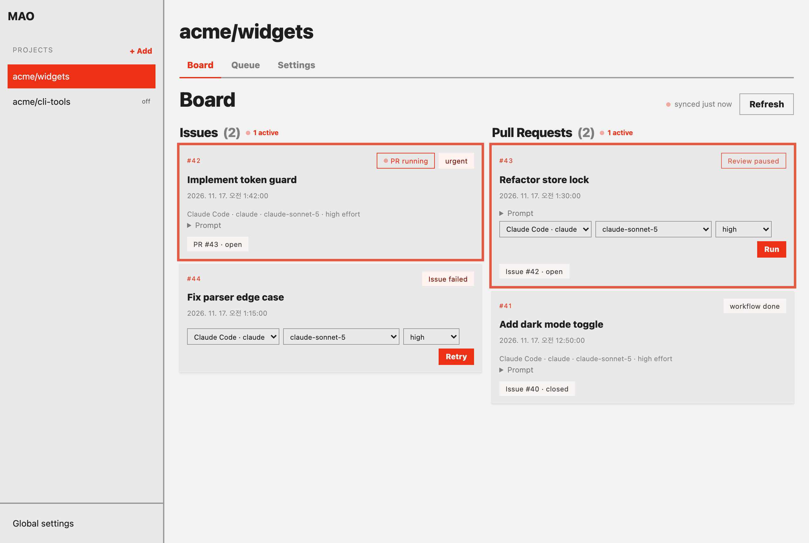 | 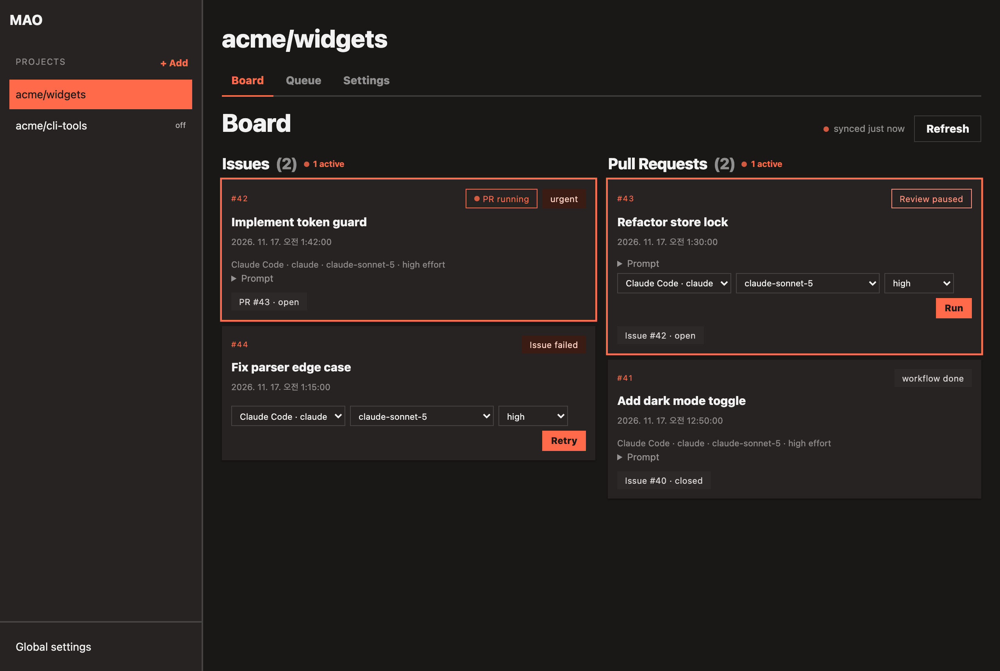 |

| Crimson Signal — Light | Crimson Signal — Dark |
| --- | --- |
| 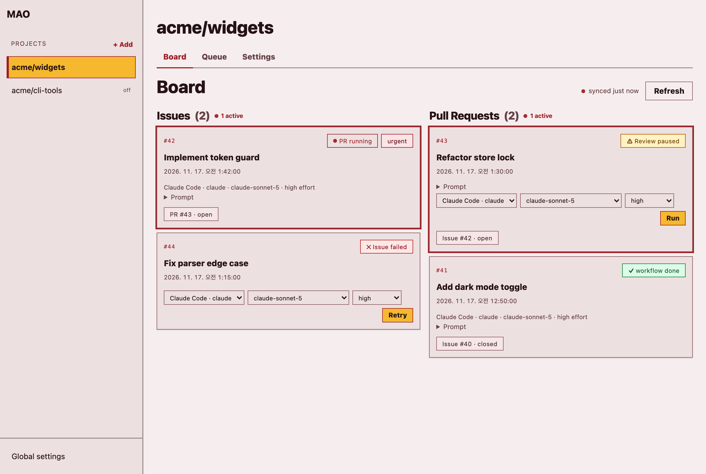 | 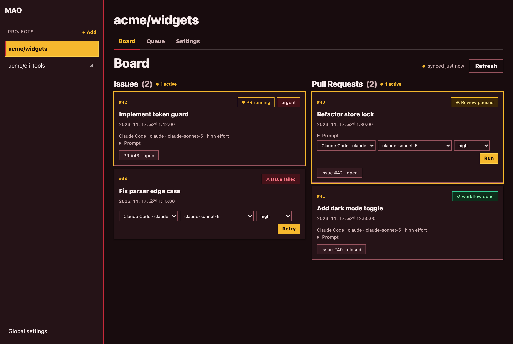 |

| Developer Console — Light | Developer Console — Dark |
| --- | --- |
| 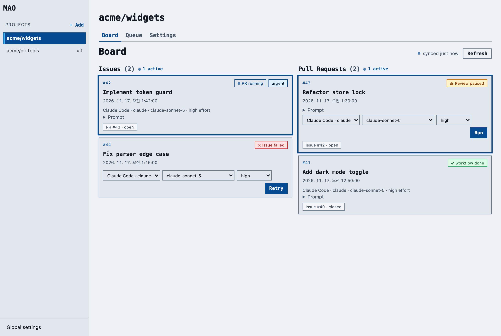 | 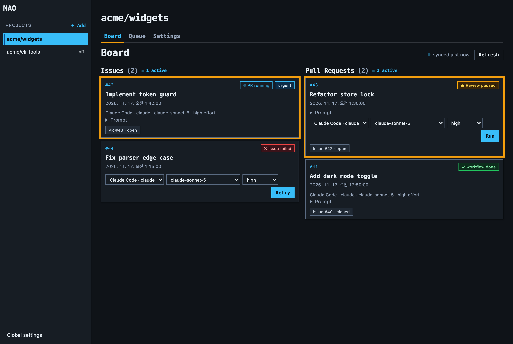 |

| Minimal Workspace — Light (탐색 전용 후보) | Editorial / Industrial — Light (탐색 전용 후보) |
| --- | --- |
| 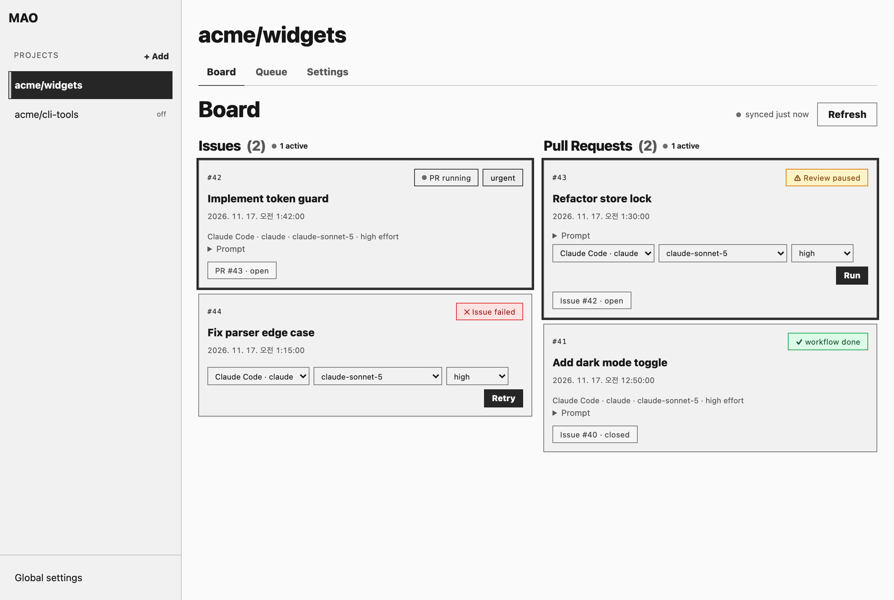 | 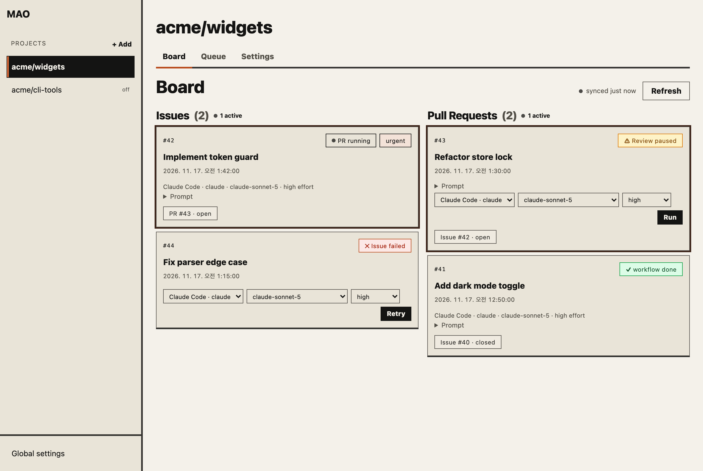 |

> **탐색 전용 후보 프리뷰 방법**: `minimal`과 `editorial`은 `core/design-system.ts`의 `EXPLORED_DESIGN_CANDIDATES`로 분리되어 런타임 선택기(`DESIGN_IDS`)에는 노출되지 않지만, `src/index.css`에 1:1 시맨틱 토큰 블록과 대비율 검증 테스트(`core/design-system.test.ts`)가 유지되므로 `<html data-design="minimal">` 또는 `<html data-design="editorial">` 속성으로 직접 검증·프리뷰할 수 있습니다.

### 3.2 Workflow Queue (시맨틱 상태, 코드 블록, 고밀도 비교)

| Crimson Signal — Dark (`Show prompt/output` 확장, `.card-subtle`·`.code-block`·`.card-active`·`✕`/`⚠`/`✓`) | Developer Console — Dark (동일 `1280×860` 뷰포트 고밀도 배치) |
| --- | --- |
| 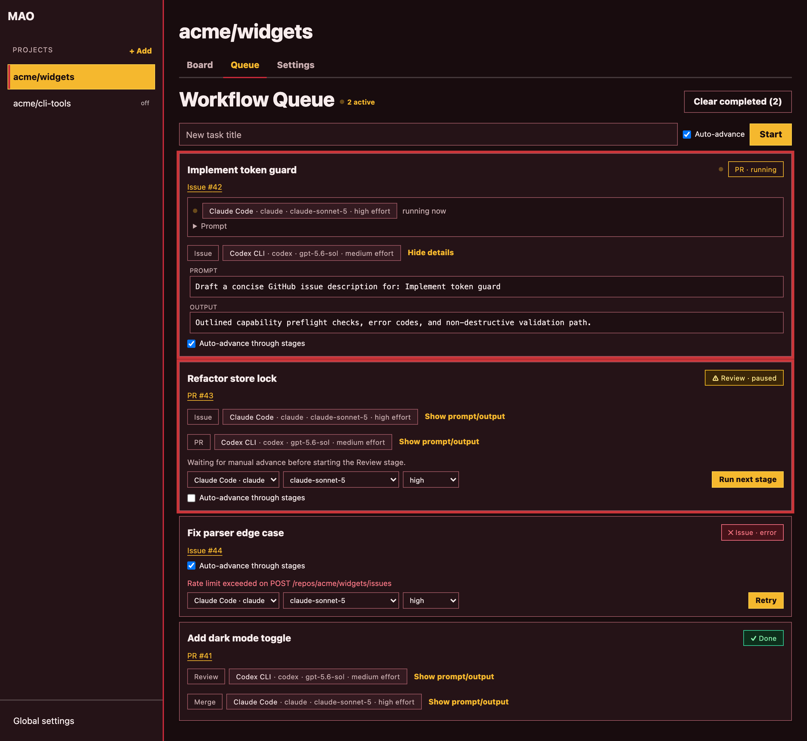 | 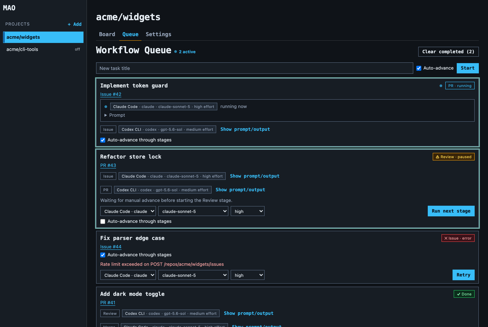 |

- **`queue-crimson-dark.png`**: 실행 중 카드(`#42`)의 `.card-subtle` 내부 블록과 확장된 `PROMPT`/`OUTPUT` `.code-block`, 리뷰 일시정지 카드(`#43`)의 `.card-active` 링 및 `⚠ Review · paused`, 실패 카드(`#44`)의 `✕ Issue · error` 및 오류 텍스트(`#ff7a88`), 완료 카드(`#41`)의 `✓ Done` 배지, 그리고 노란색(`#f5b82e`) 주요 액션 버튼(`Start`, `Run next stage`, `Retry`) 및 사이드바 선택 행 + `#c92a3a` 크림슨 보더/스트라이프가 한 화면에서 명확히 구별됩니다.
- **`queue-console-dark.png`**: 동일한 `1280×860` 뷰포트 한 화면 안에서 4개 작업 카드(`#42`, `#43`, `#44`, `#41`)가 모두 동시에 가시 영역에 진입해(카드 `#41`의 `Review` 이력 행까지 노출되고 최하단 `Merge` 행만 `860px` 경계에 걸림) `Classic`/`Crimson` 대비 실질적으로 향상된 수직 정보 밀도를 확인할 수 있습니다.

### 3.3 Global Settings (Appearance 선택기 및 `:focus-visible` 키보드 탐색)

| Classic — Light (`Design system` 3열 프리셋 카드, 래핑 없는 배지, `Save changes`) | Crimson Signal — Dark (활성 선택 카드, 다크 스와치, `Save changes`) |
| --- | --- |
| 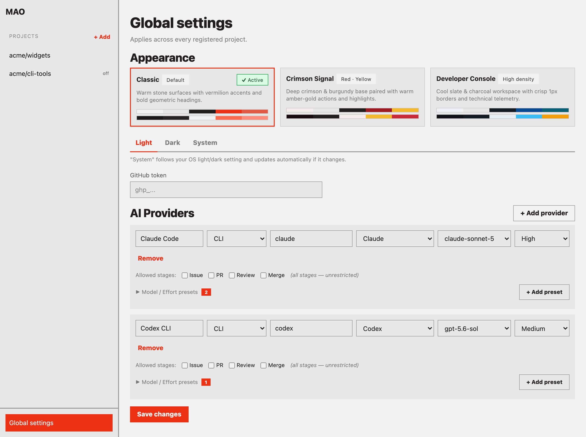 | 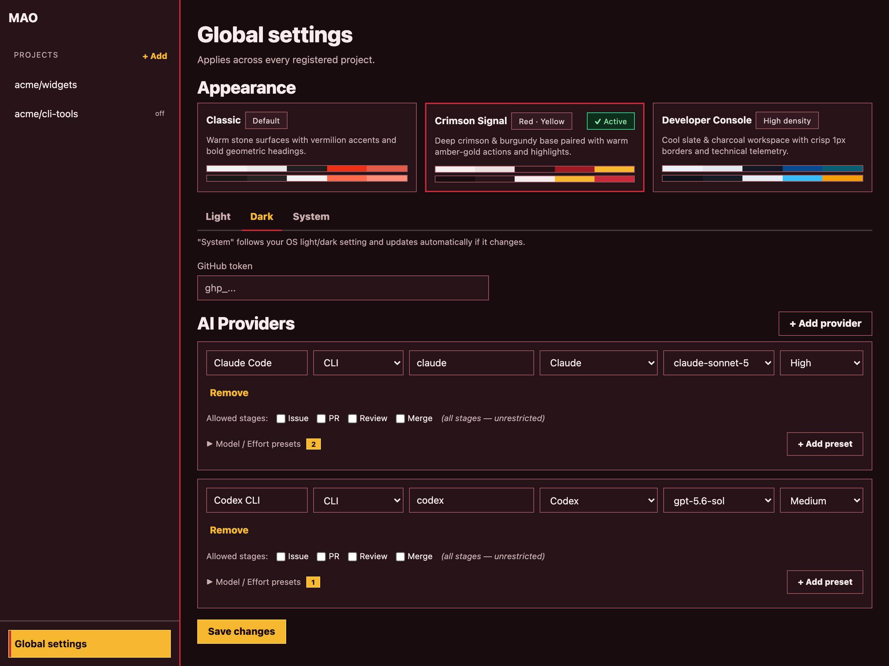 |

| Crimson Signal — Light (`Tab` 키보드 이동 시 `:focus-visible` `2px solid #6e4700` 아웃라인 렌더링) |
| --- |
| 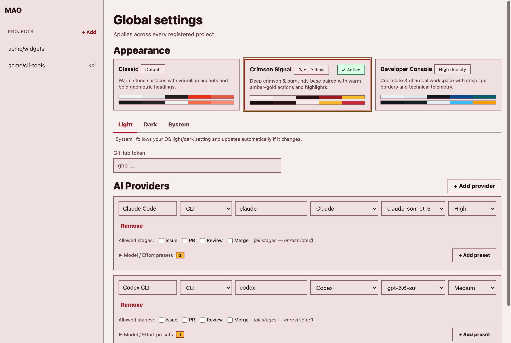 |

---

## 4. 구현 대상 선정 근거 및 시맨틱 토큰 계약

### 4.1 선택 가능한 프리셋 (`DESIGN_IDS = ['classic', 'crimson', 'console']`)
1. **`Classic` (`classic` — 기본값)**: 기존 MAO의 웜 스톤·버밀리온 시각 언어를 100% 보존합니다. `config.json`에 `design`이 없거나 잘못된 값이 들어와도 `normalizeDesignId()`가 `'classic'`으로 안전하게 폴백합니다.
2. **`Crimson Signal` (`crimson` — 레드·옐로 디자인)**:
   - **Light 모드**: 로즈-옥사이드 캔버스(`#f6eeee` / `#ede0e0` / `#e5d4d5`)와 딥 크림슨 브랜드/테두리(`#9e1b24`, `#8c5c61`)를 베이스로 두고, 주요 액션(`.btn-primary`)·활성 사이드바(`.sidebar-item.active`)·하이라이트에 웜 앰버 골드(`#f5b82e`, 전경 `#261214` 대비 **`9.99:1` AAA**)와 크림슨 인디케이터(`#9e1b24`, **`4.47:1`**)를 배치하며, 키보드 포커스 링은 고대비 딥 앰버(`#6e4700` — `bg` `7.17:1`, `surface` `6.37:1`, `bg-subtle` `5.74:1`)를 사용합니다.
   - **Dark 모드**: 딥 옥스블러드/버건디 바탕(`#180c0e` / `#251317` / `#1e0f12`)과 크림슨 구조선(`.sidebar` 우측 보더 및 `--color-highlight` `#c92a3a` — `bg` `3.53:1`, `surface` `3.27:1`) 위에 웜 앰버 골드(`#f5b82e`, 전경 `#180c0e` 대비 **`10.73:1` AAA**) 액션/선택 행과 `#c92a3a` 인디케이터(`3.04:1`), `#ffd24c` 포커스 링(`13.28:1`)을 조합합니다.
3. **`Developer Console` (`console` — 추가 선정 고밀도 디자인)**:
   - **Light 모드**: 쿨 슬레이트 바탕(`#eef1f5` / `#e2e7ee` / `#d6dde7`), 코발트 액센트/포커스/액션(`#064b91` — `bg` `7.65:1`, `surface` `6.97:1`, `bg-subtle` `6.34:1`; 전경 `#f8fafc` 대비 **`8.28:1` AAA**), 틸 하이라이트(`#065f73` — `bg` `6.41:1`), 스카이 인디케이터(`#38bdf8` — `4.05:1`), 1px 보더(`#6b7b8f` — `3.82:1` / `3.48:1`).
   - **Dark 모드**: 차콜-슬레이트 바탕(`#0f1318` / `#171d24` / `#12171d`), 스카이 액센트/포커스/액션(`#38bdf8` — `bg` `8.70:1`, `surface` `7.92:1`; 전경 `#09111a` 대비 **`8.86:1` AAA**), 앰버 하이라이트(`#f59e0b` — `bg` `8.68:1`), 코발트 인디케이터(`#064b91` — `4.05:1`), 보더(`#5a6b82` — `3.43:1` / `3.12:1`).
   - **고밀도 레이아웃 조정**: 본문 `13px`(`line-height: 1.4`), 제목 `h2: 24px` / `h3: 19px` / `h4: 16px`, 사이드바 `228px`, 컴팩트 스페이싱(`--space-1/2/3/4/6/8`: `3px`/`6px`/`8px`/`12px`/`16px`/`22px`), `.card` 패딩 `8px 10px`(`gap: 5px`), `.btn` `12px`, `.input:not(.input-sm)` 최소 높이 `30px`, `.tag` `10px`.

### 4.2 시맨틱 CSS 토큰 매트릭스 (`src/index.css`)

| 시맨틱 토큰 | `classic` (Light / Dark) | `crimson` (Light / Dark) | `console` (Light / Dark) |
| --- | --- | --- | --- |
| `--color-bg` | `#f3f2f2` / `#1a1817` | `#f6eeee` / `#180c0e` | `#eef1f5` / `#0f1318` |
| `--color-surface` | `#eae9e9` / `#262322` | `#ede0e0` / `#251317` | `#e2e7ee` / `#171d24` |
| `--color-bg-subtle` | `#e2e0df` / `#1f1c1b` | `#e5d4d5` / `#1e0f12` | `#d6dde7` / `#12171d` |
| `--color-text` | `#201e1d` / `#f3f2f2` | `#261214` / `#f7ecec` | `#111822` / `#e6edf3` |
| `--color-text-muted` | `#5c5755` / `#b8b2b0` | `#664246` / `#c9aeb0` | `#475569` / `#94a3b8` |
| `--color-border` | `#cfcaca` / `#3d3836` | `#8c5c61` / `#98545f` | `#6b7b8f` / `#5a6b82` |
| `--color-divider` | `rgb(32 30 29 / 0.4)` / `rgb(243 242 242 / 0.16)` | `rgb(38 18 20 / 0.36)` / `rgb(247 236 236 / 0.2)` | `rgb(17 24 34 / 0.28)` / `rgb(230 237 243 / 0.16)` |
| `--border-structural-width` | `2px` / `2px` | `2px` / `2px` | `1px` / `1px` |
| `--color-accent` | `#ec3013` / `#ff6a4a` | `#9e1b24` / `#f5b82e` | `#064b91` / `#38bdf8` |
| `--color-highlight` | `#e15b47` / `#ff8f78` | `#f5b82e` / `#c92a3a` | `#065f73` / `#f59e0b` |
| `--color-action-bg` | `#ec3013` / `#ff6a4a` | `#f5b82e` / `#f5b82e` | `#064b91` / `#38bdf8` |
| `--color-action-hover` | `#dd2b0f` / `#ff8465` | `#e5a519` / `#e5a519` | `#043970` / `#7dd3fc` |
| `--color-action-text` | `#f3f2f2` / `#1a1817` | `#261214` / `#180c0e` | `#f8fafc` / `#09111a` |
| `--color-action-border` | `transparent` / `transparent` | `#9e1b24` / `#ffd24c` | `transparent` / `transparent` |
| `--color-active-border` | `#e15b47` / `#ff8f78` | `#9e1b24` / `#c92a3a` | `#064b91` / `#f59e0b` |
| `--color-action-indicator` | `#f3f2f2` / `#1a1817` | `#9e1b24` / `#c92a3a` | `#38bdf8` / `#064b91` |
| `--color-focus` | `#ec3013` / `#ff8465` | `#6e4700` / `#ffd24c` | `#064b91` / `#38bdf8` |
| `--color-accent-100` / `800` | `#fff2ef`·`#7c1405` / `#3a1c14`·`#ffd3c4` | `#fbe4e6`·`#5c0b12` / `#421218`·`#ffd6da` | `#dff0ff`·`#022042` / `#0c2d48`·`#e0f2fe` |
| `--color-danger-bg` / `text` / `border` | `#fff2ef`·`#ae1800`·`#ec3013` / `#3a1c14`·`#ffab94`·`#ff6a4a` | `#fde8e8`·`#8c0b15`·`#b91c1c` / `#451219`·`#ff7a88`·`#fb7185` | `#fee2e2`·`#991b1b`·`#dc2626` / `#3b1219`·`#fca5a5`·`#ef4444` |
| `--color-warn-bg` / `text` / `border` | `transparent`·`#e15b47`·`#e15b47` / `transparent`·`#ff8f78`·`#ff8f78` | `#fff3c4`·`#6e3a00`·`#b45309` / `#3b2607`·`#fde68a`·`#fbbf24` | `#fef3c7`·`#92400e`·`#d97706` / `#382408`·`#fcd34d`·`#f59e0b` |
| `--color-success-bg` / `text` / `border` | `#f8f4f4`·`#444141`·`transparent` / `#2c2928`·`#d8d4d4`·`transparent` | `#dcfce7`·`#14532d`·`#15803d` / `#0d2e1b`·`#86efac`·`#34d399` | `#dcfce7`·`#166534`·`#16a34a` / `#0c2d1c`·`#86efac`·`#22c55e` |
| `--color-badge-active-bg` / `text` / `border` | `#dcfce7`·`#14532d`·`#16a34a` / `#0f2e1c`·`#86efac`·`#22c55e` | 동일 (`--color-success-*`) | 동일 (`--color-success-*`) |
| `--font-heading` | `'Archivo', system-ui, sans-serif` | `'Archivo', system-ui, -apple-system, sans-serif` | `'SFMono-Regular', 'JetBrains Mono', 'Menlo', 'Consolas', monospace` |
| `--font-body` | `'Archivo', system-ui, sans-serif` | `'Archivo', system-ui, -apple-system, sans-serif` | `system-ui, -apple-system, 'Segoe UI', sans-serif` |
| `--font-mono` | `'SFMono-Regular', 'JetBrains Mono', 'Menlo', 'Consolas', monospace` | 동일 | 동일 |

> **참고 (`classic` 오류 대비)**: Classic Light에서 `.btn-primary`의 `#f3f2f2` on `#ec3013` 대비율은 `3.76:1`로 기존 시각 호환을 위해 원형 유지되었으며, `.text-danger`(`#ae1800`)는 `bg` 위 `6.41:1` / `danger-bg` 위 `6.55:1`, `.tag-danger`(`#7c1405` on `#fff2ef`)는 `9.80:1`을 만족합니다. 반면 `crimson` Light의 `#8c0b15` on `#fde8e8`(`8.23:1`), `crimson` Dark의 `#ff7a88` on `#451219`(`6.20:1`, 본문 `#f7ecec`과의 RGB 거리 및 명도 차로 백색 텍스트와도 명확히 구분됨), `warn`(`8.32:1` / `11.50:1`), `success`(`8.30:1` / `10.50:1`)는 모두 WCAG AA 이상을 충족합니다.

### 4.3 브랜드 색상(레드·옐로)과 의미 상태의 분리 규칙
1. **전용 상태 토큰 분리 (`:not([data-design='classic'])`)**: 작업 실패(`.tag-danger`), 일시정지(`.tag-warn`), 완료(`.tag-success`), 실행 중(`.tag-outline` + `.live-dot` + `.card-active`)을 각각 독립된 배경·테두리·전경 토큰으로 분리했습니다.
2. **비색상(Non-color) 상태 식별자 병행**: 비-Classic 프리셋에서는 모든 상태 배지에 텍스트 라벨과 함께 상태 기호(`✕` 실패, `⚠` 일시정지, `●` 실행 중 펄스 점, `✓` 완료)를 결합합니다. (`GlobalSettings`의 활성 프리셋 카드 `.design-option .tag-success`는 모든 프리셋에서 `✓ Active`와 `--color-badge-active-*`를 사용합니다.)
3. **일관된 키보드 포커스 피드백**: 모든 대화형 요소가 `:focus-visible` 시 `2px solid var(--color-focus)`와 `outline-offset: 2px`를 표시합니다.

---

## 5. 아키텍처 연동 및 검증 요약

### 5.1 Core · Store · IPC · CLI · Renderer 동기화
- **단일 순수 계약 (`core/design-system.ts`)**: Node 내장 모듈과 런타임 `core/` 의존성이 없는 순수 모듈로, `DESIGN_IDS`, `DEFAULT_DESIGN_ID`, `DESIGN_PRESETS`, `EXPLORED_DESIGN_CANDIDATES`, `isDesignId()`, `normalizeDesignId()`, `getDesignPreset()`를 제공합니다.
- **영속화 및 폴백 (`core/store.ts`)**: `MaoStoreSchema.design` 필드를 추가하고 기본값을 `'classic'`으로 설정했습니다. 손상되거나 알 수 없는 값은 `normalizeDesignId()`가 `'classic'`으로 폴백합니다.
- **IPC 및 Preload 락스텝 (`electron/ipc.ts`, `electron/preload.ts`, `src/electron.d.ts`, `src/test/electron-api-stub.ts`)**: `ui:getDesign`과 `ui:setDesign`을 4개 락스텝 파일과 일치시켰습니다.
- **GUI↔CLI 패리티 (`cli/index.ts`, `src/App.tsx`, `src/components/GlobalSettings.tsx`)**:
  - CLI에서 `mao config set-design <classic|crimson|console>` 및 `mao config show`의 `"design"` 필드로 디자인 프리셋을 조회·변경할 수 있습니다.
  - 렌더러(`src/App.tsx`)는 마운트 시 `ui:getDesign()`과 `ui:getTheme()`를 읽어 `<html data-design="...">` 및 `<html data-theme="...">`에 반영하며, 저장 실패 시 마지막 확인 상태로 롤백하고 `role="alert"`(`Dismiss` 버튼 포함)로 오류를 표시합니다.

### 5.2 검증 게이트 요약
- `npm run lint` (`tsc --noEmit`): 타입 및 IPC 브리지 계약 검증 통과
- `core/design-system.test.ts`: 10개 CSS 토큰 블록(`classic`/`crimson`/`console`/`minimal`/`editorial` × Light/Dark)의 스와치 일치성, WCAG 대비율, 고밀도 `console` 규칙, `:focus-visible` 커버리지, Classic 시각 격리 가드 검증 통과
- `core/agent-docs.test.ts`: 에이전트 문서 크기 제한·참조 무결성·아키텍처 규칙 번호 불변 검증 통과
- `npm run test` (`core` + `renderer` 프로젝트), `npm run test:origin`, `npx vite build`, `npm run build:cli` 검증 완료
